# Termoil

**A fast, light terminal for Windows, macOS and Linux.**

Termoil is a terminal emulator written from scratch in Rust. It has tabs, splits, images, ligatures, nearly 900
themes and a command palette, and it uses a fraction of the memory and processor time of other modern terminals.
Every action it has can also be run from the command line or by an AI agent.

[Download](https://github.com/Black-Rainbow-Labs/Termoil/releases) &nbsp;·&nbsp;
[Documentation](#documentation) &nbsp;·&nbsp;
[Install](#install) &nbsp;·&nbsp;
[For AI agents](#for-ai-agents)

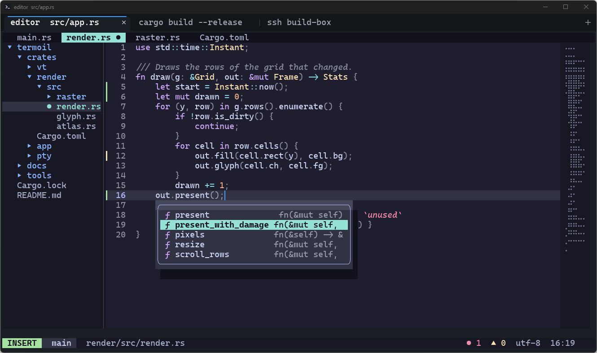

## Features

- Uses 94% less memory than Ghostty at idle: 13.2 MB against 207.9 MB.[^1]
- Uses 83% less processor time than Ghostty to show the same 100 MB of output.[^1]
- Reads program output 14% faster than Ghostty 1.4 and 226% faster than Alacritty's terminal core.[^2]
- A key press reaches the screen in under 2 ms at the median and under 5 ms at the 99th percentile.[^3]
- A new window shows its prompt in 79 ms.[^3]
- Tabs and splits built in, with no multiplexer to install.
- Images in the terminal through the kitty graphics protocol, sixel and iTerm2 inline images.
- 24 bit colour, ligatures, colour emoji, five underline styles and Unicode 17 text widths.
- 894 colour themes, with a theme picker that previews each one as you move through the list.
- A command palette that lists every action and its key.
- Shell integration for PowerShell, bash, zsh, fish, nushell and cmd: jump between prompts, select the output of
  the last command, and see a failed command's exit code in its tab.
- 22 built in shaders (neon glow, CRT, retro monitor, neon, amber and green phosphor, VHS, glitch, Game Boy and more) that combine with any color theme, 20 cursor effects that combine with any shader, and your own shaders written in WGSL.
- A command line and an MCP server that reach the same 65 actions as the keyboard and the mouse.
- Anonymous usage statistics (which actions are used, how long Termoil is open), on by default and turned off
  with `[telemetry] enabled = false`. No other network connections except the update check.

## Documentation

The pages in this repository are listed in [docs/README.md](docs/README.md). Good places to start:

| Page | What it covers |
|---|---|
| [Getting started](docs/getting-started.md) | installing, the first window, the keys to know, shell integration |
| [Configuration](docs/configuration.md) | the settings file, themes, fonts, keybindings and the tab bar |
| [Commands](docs/commands.md) | every action, with its command line form and its MCP tool |
| [Scripting and AI agents](docs/scripting-and-agents.md) | driving Termoil from a script, the IPC socket and the MCP server |
| [Architecture overview](docs/architecture-overview.md) | the crates, the threads, and how output becomes pixels |
| [Performance](docs/performance.md) | every speed and memory measurement, and how each was taken |
| [Feature matrix](docs/feature-matrix.md) | each feature, where it lives in the code and the test that covers it |
| [Glossary](docs/glossary.md) | the terminal terms these pages use |

## Install

Download the file for your system from the
[releases page](https://github.com/Black-Rainbow-Labs/Termoil/releases).

| System | File | Notes |
|---|---|---|
| Windows 10 and 11, x64 | `TermoilSetup-<version>-x64.exe` | Installs for your user with no administrator rights and puts `termoil` on your `PATH` |
| Linux, x86_64 | `termoil-<version>-x86_64.AppImage` | Runs anywhere: `chmod +x` it and start it |
| Debian and Ubuntu | `termoil_<version>_amd64.deb` | `sudo apt install ./termoil_<version>_amd64.deb` |
| macOS, Apple silicon and Intel | `termoil-<version>-macos-universal.dmg` | Signed with an Apple Developer ID and notarised by Apple |

The Windows build is the one tested most. The Linux packages have been tested under WSL, and the macOS build is
cross compiled on Windows and has not yet been run on a Mac. [The feature matrix](docs/feature-matrix.md) lists what
has been run on each system.

To build it yourself, install Rust and run `cargo build --release -p termoil-app -p termoil-cli`.
[Repository and building](docs/repository.md) has the details.

## The first few minutes

Start Termoil from the Start menu, Spotlight or your launcher, or run `termoil-gui`. It opens your usual shell:
PowerShell 7 if you have it on Windows, otherwise Windows PowerShell, and `$SHELL` on macOS and Linux.

| Keys on Windows and Linux | Keys on macOS | What they do |
|---|---|---|
| `Ctrl+Shift+T` | `Cmd+T` | open a tab |
| `Ctrl+Shift+D` | `Cmd+D` | split the pane, new pane on the right |
| `Ctrl+Shift+E` | `Cmd+Shift+D` | split the pane, new pane below |
| `Alt+Arrow` | `Cmd+Alt+Arrow` | move to the pane in that direction |
| `Ctrl+Shift+W` | `Cmd+W` | close the pane |
| `Ctrl+Shift+P` | `Cmd+Shift+P` | open the command palette |
| `Ctrl+Shift+F` | `Cmd+F` | search the scrollback |
| `Ctrl+Shift+Up` | `Cmd+Up` | scroll to the previous prompt |
| `Ctrl+,` | `Cmd+,` | open the settings |

Shell integration is on from the start: Termoil loads a small script into each shell it opens, which marks every
prompt and command. That is what makes the prompt keys, the exit codes in tabs and "select last output" work.
[Getting started](docs/getting-started.md) covers the rest.

## What it does

### Tabs and splits without a multiplexer

Open as many tabs as you like and split any of them into panes, side by side or one above the other, nested as deep
as you want. Drag a divider or use the keyboard to resize. Zoom one pane to fill its tab and zoom back out. The tab
bar stays out of the way: it appears when you open a second tab and goes away when you close back down to one. A tab
named after its shell shows the exit code of a command that failed and the progress of a long command that reports it.

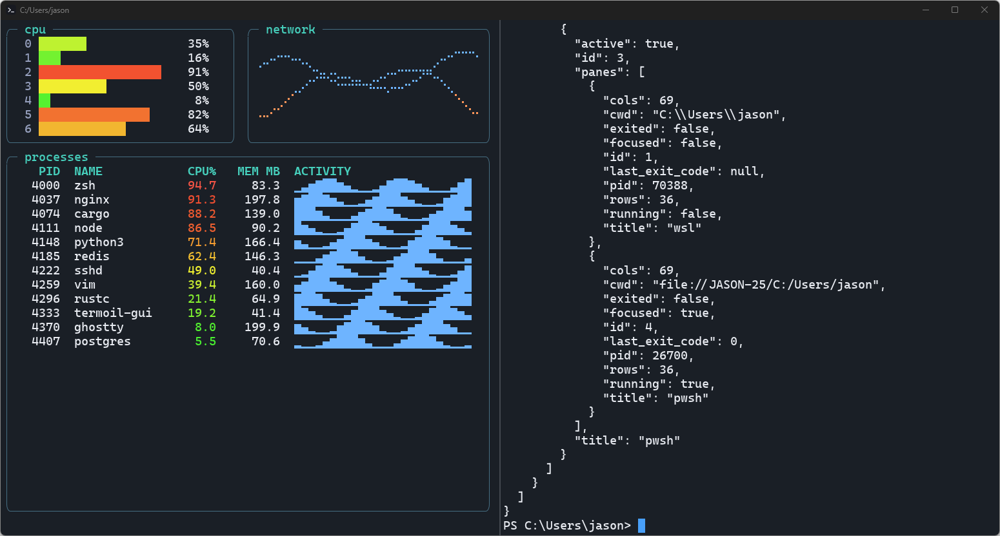

### Pictures in the terminal

Programs can draw real images in Termoil through the kitty graphics protocol, sixel or iTerm2 inline images.
Animated kitty images play. On Windows, Termoil ships its own copy of Microsoft's console host so these pictures
reach the terminal; the console host built into Windows removes them.

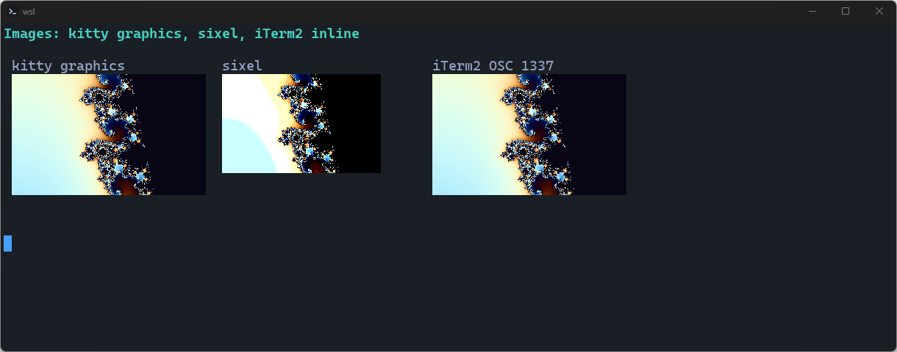

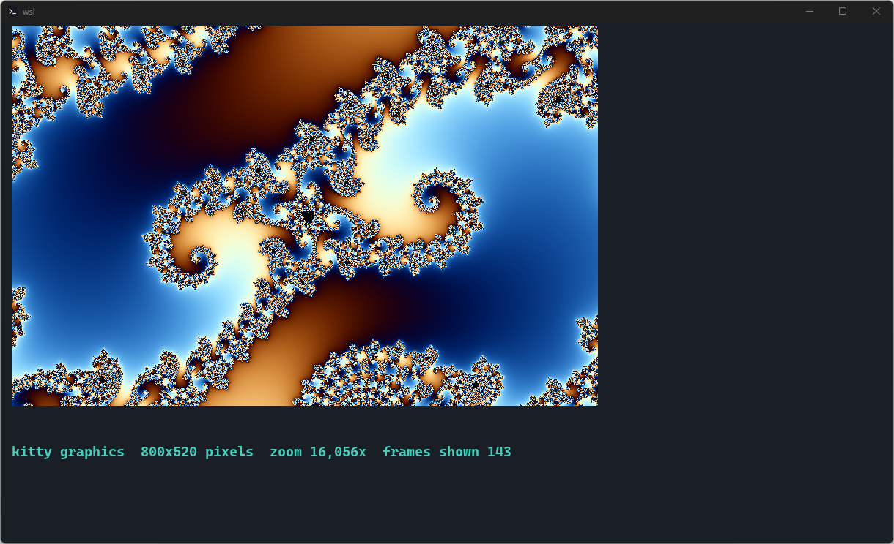

### Every colour and every style

24 bit colour, the 256 colour palette, bold, italic, faint, strikethrough, overline and five kinds of underline in any
colour, including the curly underline editors use for spelling and compiler errors. Box drawing, block and braille
characters are drawn by Termoil itself, so they join cleanly at any font size.

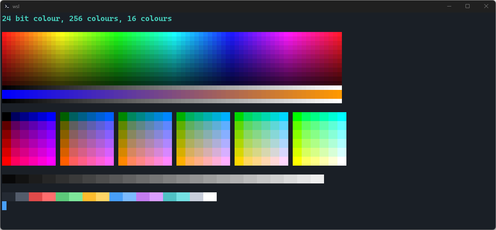

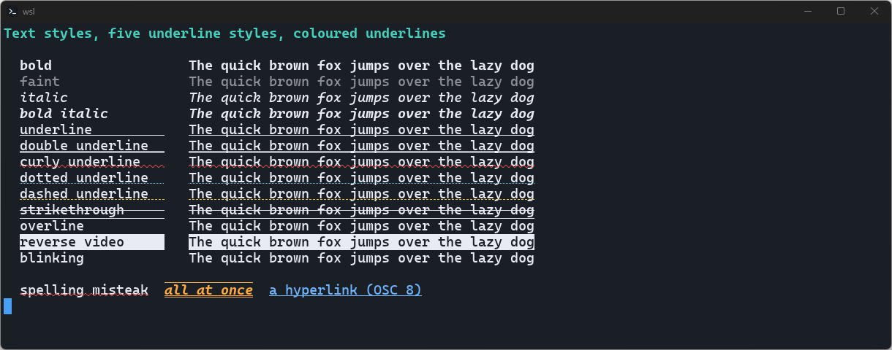

Programs that draw pictures out of coloured half blocks, such as btop, chafa and image previews in file managers, get
exactly the colours they send.

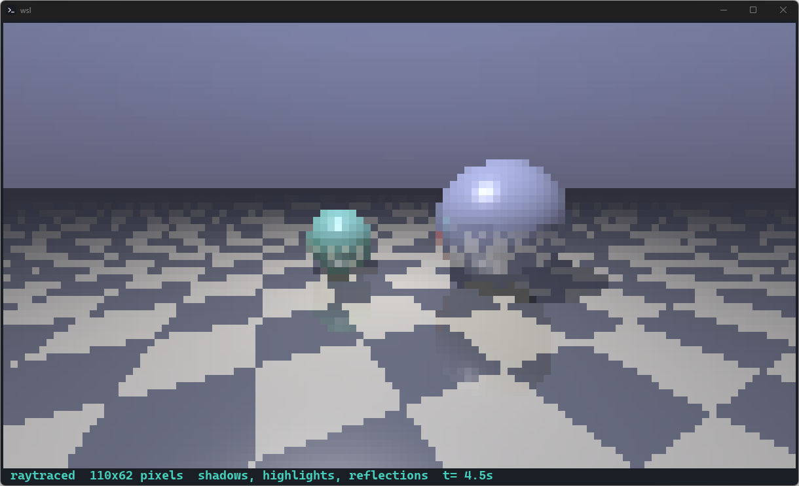

### Text from every language

Emoji, including the multi part ones such as families and flags, wide Chinese, Japanese and Korean text, combining
accents, and programming ligatures in fonts that have them. Character widths follow Unicode 17, and a missing
character falls back to another installed font.

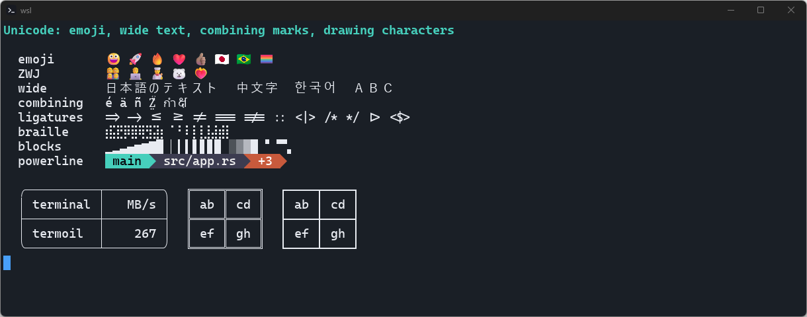

### 894 themes

Termoil bundles the full iTerm2 colour scheme collection plus the Unluminous themes. Open the theme picker from the
command palette and each theme is applied to your terminal as you move to it, so you see your own work in it before
you choose. Termoil can follow the system's light and dark setting with a theme for each.

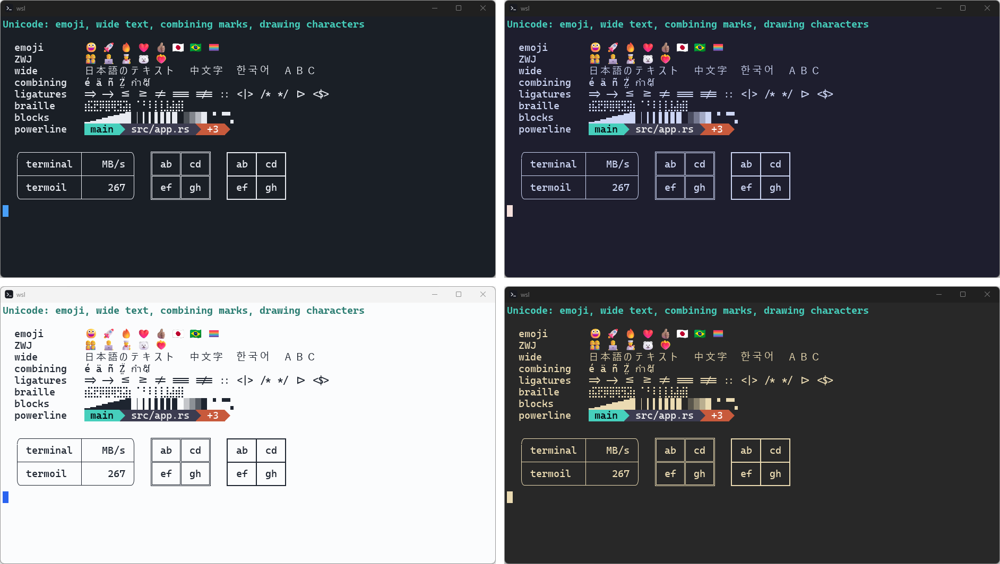

### One palette for every action

`Ctrl+Shift+P` opens a list of every action Termoil has, with the key bound to each one. Type a few letters to filter
it and press Enter to run one. You never have to remember a key you rarely use.

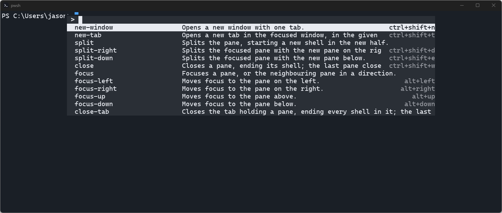

### Shaders

Termoil ships 22 shaders: `neon-glow`, `crt`, `retro`, `neon`, `amber`, `green-phosphor`, `scanlines`, `bloom`, `vhs`, `glitch`,
`chromatic`, `vignette`, `film-grain`, `tft`, `game-boy`, `sepia`, `noir`, `hologram`, `synthwave`, `underwater`,
`cursor-glow` and `blueprint`. The theme picker (`choose-theme`) lists them on the right of the themes: Right moves to
the shader list, Up and Down preview, and Enter keeps the theme and the shader together. `termoil +set-shader crt`
and `window.shader = "crt"` do the same, and `none` turns the shader off.

It also ships 20 cursor effects, such as `glow`, `sonar`, `orbit`, `flame` and `magnify`, drawn around the cursor
after the shader. The theme picker lists them in a third column right of the shaders. A chosen cursor effect replaces
the cursor light of the shader. `termoil +set-cursor-effect sonar` and `window.cursor_effect = "sonar"` do the same.

`window.shader` can also name a WGSL file that Termoil runs over every frame. Two examples come with it: a CRT screen with
scanlines and curvature, and a glow that follows the cursor. [Custom shaders](docs/shaders.md) explains how to write
your own.

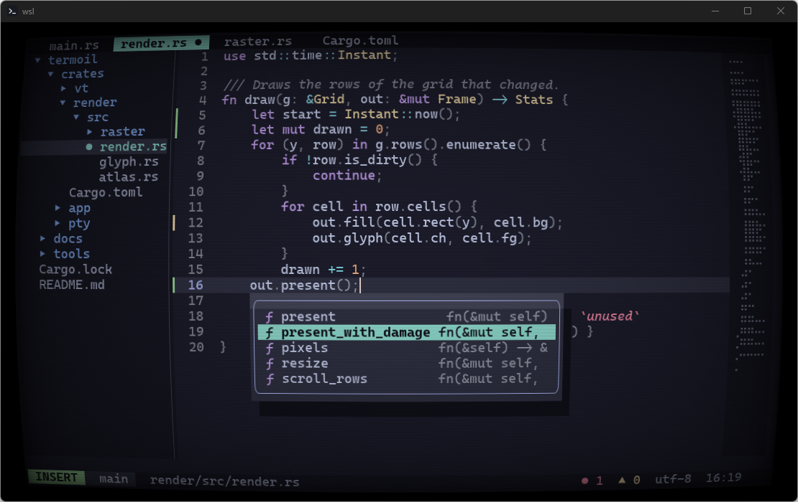

### Light on your machine

An idle Termoil window takes 13.2 MB of private memory, against 207.9 MB for Ghostty, and uses no processor time at
all. Streaming 100 MB of output through it costs 15.5 seconds of processor time against Ghostty's 89.8.[^1] A million
lines of scrollback fit in 143 MB, because history you are not looking at is compressed.[^4] The window draws on the
processor by default, which is fast enough for 4.67 ms frames at the 99th percentile, and starts the graphics card
only when you ask for it or set a shader.[^3]

### Correct where it matters

Termoil passes the same esctest2 conformance cases as Ghostty 1.4, runs Alacritty's reference tests and vttest, and
implements the kitty keyboard protocol with all five of its flags, so editors such as Neovim and Helix get every key
combination. The parser is fuzzed and every buffer it keeps has a fixed limit, so a hostile stream of output cannot
make Termoil use unbounded memory.

## For AI agents

Every action in Termoil is a row in one catalogue, and the keyboard, the command palette, the command line and the
MCP server all run actions through the same function. An agent can open a tab, type into it, wait for the command to
finish and read the screen:

```sh
termoil +new-tab --name build
termoil +send-text --text "cargo build --release"
termoil +send-key --key enter
termoil +wait-prompt --timeout 600      # returns the exit code of the command
termoil +screen                         # the visible text; --json true gives cells with colours
```

`wait-prompt` knows a command has finished from the prompt marks that shell integration adds.

To give an agent the same commands as MCP tools:

```json
{
  "mcpServers": {
    "termoil": {
      "command": "termoil",
      "args": ["+mcp"]
    }
  }
}
```

The 30 tools and [docs/commands.md](docs/commands.md) are generated from the catalogue, and a test fails if either
drifts from it. [Scripting and AI agents](docs/scripting-and-agents.md) has the details.

## Licence

MIT OR Apache-2.0, at your option. See [LICENSE-MIT](LICENSE-MIT) and [LICENSE-APACHE](LICENSE-APACHE).

[^1]: Measured on 2 November 2026 with `termoil-bench apps` on Windows 11 24H2, an Intel Core Ultra 9 285 and an
    NVIDIA GeForce RTX 5090, against Ghostty for Windows 1.3.0 (`shiweis/ghostty-windows`, a fork of Ghostty with a
    Win32 window). Both terminals ran in a 120 by 34 window with their default settings, and each figure is the
    median of three alternating runs, measured on the terminal's own process. Idle memory is private bytes. The
    output test runs `type` on a 100 MB file. [Performance](docs/performance.md#the-whole-application-against-ghostty-task-2481-2026-11-02)
    has every row.

[^2]: The `mixed` stream, 1 GiB of build log style output with colours, Unicode and progress bars, fed through each
    terminal's parser and screen on one core at 200 by 60 cells: Termoil 267 MB/s, Ghostty 1.4 234 MB/s and
    alacritty_terminal 0.26 82 MB/s, the median of three runs on 2 November 2026.
    [Performance](docs/performance.md#p1-comparison) says how each column was measured.

[^3]: Measured on 2 November 2026 on the same machine with the default renderer: key to the frame that shows it
    over three runs of 800 keys, p50 1.74 to 1.84 ms and p99 4.16 to 4.63 ms; start up to the first frame with the
    prompt on a visible window, median 79.3 ms over 20 warm runs; frame time p99 4.67 ms.

[^4]: A million lines of 200 columns of typical output, measured as the private memory of the terminal core after
    idle compression: 142.5 MB. With a colour change on every cell it is 376.7 MB.
