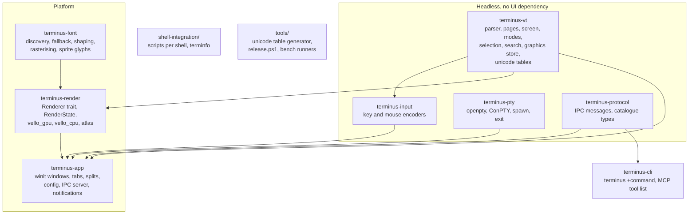
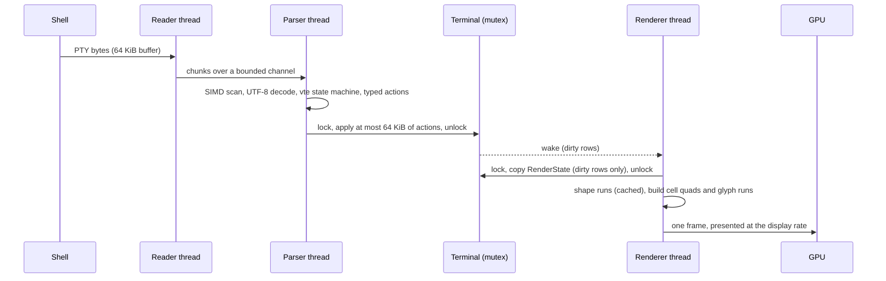
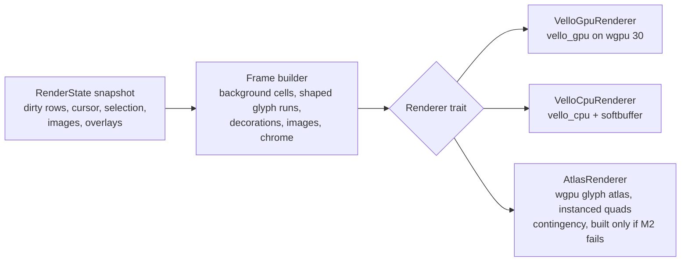
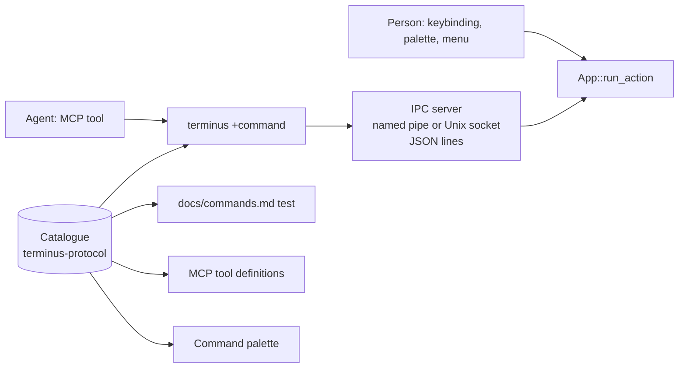

# Terminus: technical design

Written 2026-11-01 for task-2456. Requirements are in `docs/PRD.md`. The test suite is specified in `docs/TEST-SUITE.md`. Research inputs are in `docs/research/`: `feature-parity.md`, `rust-crates-and-vello.md`, `architectures.md`, `testing-corpora.md`.

## 1. Introduction

Terminus is a terminal emulator written from scratch in Rust for Windows, macOS and Linux. Its core is a headless library with no window, GPU or font dependency, the arrangement libghostty-vt and rio-vt use, so that the same core serves the Terminus window, the Unluminous IDE's terminal tile, the Tasks board's agent terminals and a future multiplexer server. Rendering goes through one `Renderer` trait with vello behind it: `vello_gpu` on wgpu for the window, `vello_cpu` behind `softbuffer` when no GPU adapter is usable, and a Terminus owned wgpu glyph atlas as the contingency if `vello_gpu` fails the frame time gate at milestone M2.

The objective is parity with Ghostty, Alacritty, WezTerm, Kitty and Windows Terminal on the feature matrix in `docs/research/feature-parity.md`, with the performance gates in the PRD section 2 measured by the test suite, on all three platforms from one code base.

## 2. Goals and non goals

Goals, each with the test that proves it (test ids are from `docs/TEST-SUITE.md`):

| Goal | Proof |
|---|---|
| Emulation correct to xterm, with the Ghostty and Kitty extensions | C1 Alacritty ref tests at 100 %, C2 esctest xterm profile at Ghostty 1.4's pass set, C3 the Terminus conformance corpus |
| Parser plus screen at 250 MB/s or more per core on the `mixed` build log stream (`docs/decisions/throughput.md`), no per byte allocation | P1 throughput benchmark, P5 allocation counter |
| Keypress to pixel p99 under 16 ms at 120 Hz | P2 latency harness |
| 100 000 lines of 200 column scrollback in under 150 MB | P3 memory benchmark |
| Startup to first prompt under 100 ms (Windows, Linux) | P4 startup benchmark |
| Core embeddable with no UI dependency | B1 `cargo build -p terminus-vt --target wasm32-unknown-unknown` and the Unluminous proof of concept |
| Every action reachable by a person and by an agent through the same code | A1 catalogue completeness tests |
| Installers for three platforms from one release command | R1 release script dry run and the installed version check |

Non goals for 1.0: a multiplexer server, a scripting runtime, bidi reordering, DRCS, VT52, ReGIS, Tektronix, telemetry, native toolkit widgets. Each is listed with its reason in the PRD sections 5.5 and 5.6, and section 4 below says where the design leaves room for the first three.

## 3. Problem statement

The emulators in use here each fail a requirement: Ghostty has no Windows GUI and will not get one, Windows Terminal is Windows only and cannot be embedded, Alacritty has no tabs, splits, ligatures or images, WezTerm has not tagged a release since 2024-02-03, Kitty is GPL 3 with no native Windows build. Unluminous embeds `alacritty_terminal` and inherits Alacritty's gaps. The Tasks board's agent terminals are Windows Terminal windows driven over ConPTY by a Node daemon with its own write chunking problems. There is no terminal core here that we own, that runs everywhere, and that has the modern feature set.

## 4. Architecture

### 4.1 Crates



Workspace rules:

- `terminus-vt`, `terminus-input`, `terminus-pty` and `terminus-protocol` have no dependency on winit, wgpu, vello or any font crate. CI builds `terminus-vt` for `wasm32-unknown-unknown` to enforce it (B1).
- `terminus-vt` allocates through one arena module; `unsafe` is confined to that module and to the SIMD scan, and both are covered by Miri and by cargo fuzz targets.
- One toolchain pinned in `rust-toolchain.toml` (1.95.0 today, the same as Unluminous), MSRV policy "current stable minus zero". vello needs 1.89, parley 1.88, wgpu 1.87; all satisfied.
- Licence MIT OR Apache-2.0. Dependencies must be MIT, Apache 2.0, BSD, Zlib, Unicode or OFL. `cargo deny` runs in CI with that allow list. Nothing is read from Kitty's source; its protocols are implemented from the published specifications.
- Every public function has a doc comment stating intent. Parameters on one line. Functions stay under about 50 lines; a long function is split into named steps.

### 4.2 Data flow: bytes to pixels



Three threads on the hot path, following Ghostty 1.4 and Alacritty:

- **Reader** reads the PTY into a 64 KiB buffer and hands chunks to the parser. It exists because the kernel caps a single PTY read at about 1 KiB on macOS and Linux, so reading and parsing on one thread leaves the pipe idle; Ghostty measured 25 % to 55 % more throughput from the split. On Windows the ConPTY pipe is synchronous and this thread is the only place it is read.
- **Parser** turns bytes into typed actions and applies them to the `Terminal` under its mutex, in slices of at most 64 KiB per lock (Alacritty's `MAX_LOCKED_READ` idea), so the renderer is never starved during a flood.
- **Renderer** (on the UI thread since M3: building a frame takes under 0.4 ms, and R4 and P2 pass without a separate thread; `docs/decisions/renderer.md`) wakes on a terminal event, holds the lock only to copy a `RenderState` snapshot of the dirty rows, and does all shaping and buffer building outside it. Ghostty needed two release cycles to get lock time down; the snapshot is the first thing built here.
- **Search** runs on its own thread and takes the lock in small slices, restoring compressed pages as it goes.
- **UI** is the winit event loop: windows, input, IME, clipboard, config reload, IPC.

Each thread talks over bounded crossbeam channels. No tokio in the core; `polling` wakes the reader on Unix.

### 4.3 The terminal core (`terminus-vt`)

**Parser.** The vt100.net state machine, written in Terminus (`docs/decisions/parser.md`: `vte` 0.15 discards APC payloads, so kitty graphics could not pass through it, and it has no OSC bound with `std`). A front end scans for the next control byte with `memchr` and decodes printable runs in bulk with `simdutf8`, so ASCII text never goes through the state machine one byte at a time. The parser emits a typed `Action` enum (`Print(&str)`, `PrintRepeat`, `Csi(..)`, `Osc(..)`, `Dcs(..)`, `Apc(..)`, cursor moves and the rest) that the stream layer applies to the terminal. Emitting values rather than calling a trait per byte is what lets the parser be tested and fuzzed on its own. Hard limits: 8 MiB per OSC payload, 65 MiB per graphics payload (Ghostty's numbers), 16 CSI parameters with 4 sub parameters each, a kitty keyboard mode stack of depth 16, 64 combining code points per cell. Anything over a limit is dropped and counted, never grown.

**Pages.** Ghostty's design, in Rust. A page is one contiguous allocation (a `Vec<u8>` sized to the page, `mmap` or `VirtualAlloc` later if measurement says zeroed pages matter) holding rows, cells, an interned style table with reference counts, a side allocator for grapheme tails, and a hyperlink set and map. Every internal reference is an offset, never a pointer, so a page can be copied, compressed and moved with one memory copy. Standard capacity: 215 columns, 215 rows, 128 styles, 8 KiB of grapheme storage. A page that needs more (many emoji, many styles) is allocated at the size it needs, and such a page is never reused during pruning. That rule is the fix for Ghostty's 37 GB leak, where an oversized page was reset to standard metadata and never unmapped.

`Cell` is a packed 64 bit value: 2 bit content tag (code point, first code point of a cluster, background only), 24 bits of content, 16 bit style id (zero is the default style, no lookup), 2 bit wide property (narrow, wide, spacer head, spacer tail), protected flag, hyperlink flag, 2 bit semantic content for OSC 133 (output, input, prompt), dirty bits spare. `Row` is a packed 64 bit header: cell offset plus flags `wrap`, `wrap_continuation`, `grapheme`, `styled`, `hyperlink`, `semantic_prompt`, `kitty_placeholder`, `dirty`. Row flags may be true when nothing remains and are never false when something exists; the `styled` flag alone made Ghostty's erase paths about four times faster.

**PageList and scrollback.** A doubly linked list of pages with a byte budget (default 50 MB per terminal, config `scrollback.limit_bytes`, plus `scrollback.limit_lines` as an alternative). Standard pages come from a pool. Cold pages (fully historical, not visible) are compressed with LZ4 on an idle timer, keeping their virtual reservation so restore cannot fail. Selections, the viewport, the cursor, OSC 133 marks and search matches are **pins**, tracked references the list updates during pruning, compression and reflow. Reflow on column change rewrites rows page by page using the `wrap` flags. The alternate screen is allocated on first use.

**Screen and Terminal.** `Screen` owns a PageList, a cursor, tab stops, scrolling region, charsets and the saved cursor; `Terminal` owns the primary and alternate screens, the mode set (every DEC and ANSI mode as a typed field, with a DECRQM answer for each: set, reset, permanently reset, or unsupported), the colour palette, the title stack, the kitty keyboard flag stack, the graphics store, the hyperlink registry and the event queue (bell, title, cwd, clipboard, notification, prompt mark, exit) that the app drains. Everything is a plain value; `terminus-vt` holds no thread or lock.

**Unicode.** Width and grapheme break tables are generated at build time by `tools/unicode-tables` from the Unicode data files, with the Unicode version written in one place (`UNICODE_VERSION` in `terminus-vt`, 17.0.0 to start; `unicode-width` 0.2.3 already carries 18). The hot path uses flat class and transition tables, as rio-vt does; the generated tables are tested against `GraphemeBreakTest.txt` and the East Asian Width file. Mode 2027 is on by default (Ghostty, Rio and Windows Terminal all cluster), and off reverts to legacy per code point width. Emoji sequences follow UTS 51 with the variation selector rules.

**Graphics store.** Kitty graphics images live outside the grid in a store with a 320 MB quota and oldest first eviction. Cells hold placeholders or placements reference pins. Transmission supports direct, file and shared memory, PNG and raw RGB and RGBA, zlib, chunking, animation frames and relative placements. Sixel decodes into the same store (should list). The store is a value in `terminus-vt`; decoding uses `image` with only the PNG feature.

**Selection, search, hints.** Selection is a pair of pins plus a mode (character, word, line, block, semantic). Search compiles a `regex` and runs over rows in page order on the search thread; results are pins. Hints (URLs, paths, custom patterns) run the same way over the visible rows plus a margin.

### 4.4 Input (`terminus-input`)

A pure function from `(KeyEvent, Modifiers, TerminalModes) -> Vec<u8>` and the same for mouse. It implements legacy xterm encoding, `modifyOtherKeys`, the kitty keyboard protocol with all five flags (disambiguate, event types, alternate keys, all keys as escapes, associated text), bracketed paste wrapping, focus events, and mouse modes 1000, 1002, 1003, 1005, 1006, 1015, 1016. Alacritty's `keyboard.rs` and Ghostty's `key_encode.zig` are the references, and the kitty keyboard protocol's own tables are the test oracle (I2). Windows specifics (AltGr as Ctrl+Alt, dead keys, the Win key) are resolved in `terminus-app` before the event reaches the encoder, so the encoder has one platform independent input.

### 4.5 PTY (`terminus-pty`)

One `Pty` trait: spawn with command, args, cwd, env and size; read and write handles; resize; wait for exit with a typed `ExitStatus` (code or signal); kill.

- Unix: `rustix-openpty`, `std::process::Command` with `pre_exec` doing `setsid` and `TIOCSCTTY`, initial size with `TIOCSWINSZ`, `signal-hook` for SIGCHLD. Login shell by default on macOS (through `login -fpq` when `~/.hushlogin` exists, `-fp` otherwise) and argv[0] with a leading dash on Linux. `TERM=xterm-terminus`, `COLORTERM=truecolor`, `TERM_PROGRAM=terminus`, `TERM_PROGRAM_VERSION`.
- Windows: `CreatePseudoConsole` through the `windows` crate, `CreateProcessW` with `PROC_THREAD_ATTRIBUTE_PSEUDOCONSOLE`. Terminus ships the matched `conpty.dll` and `OpenConsole.exe` pair from Microsoft's `Microsoft.Windows.Console.ConPTY` package beside the executable, loads it first, and falls back to the inbox kernel32 ConPTY. The pair version is written in one place (`installer/windows/conpty.version`) and the release script refuses a mismatch; WezTerm shipped an unmatched pair and crashed. The glyph width flag `PSEUDOCONSOLE_GLYPH_WIDTH_GRAPHEMES` is requested so ConPTY and Terminus agree on cluster width; a disagreement shows as cursor drift.
- Windows reflow: since ConPTY 1.22 it does not repaint after a resize, so Terminus reflows its own buffer and the test suite (W1) compares the result against ConPTY's for a set of recorded sessions.
- Windows graphics: the inbox ConPTY strips sixel (DCS) and kitty graphics (APC) sequences before the terminal sees them, reported on 24H2 builds too. A passthrough flag is claimed by third parties and is unverified. Milestone M1 includes a spike (S2) that tests the bundled ConPTY and the inbox one on this machine and writes down what reaches the terminal; the result decides whether kitty graphics on Windows is "works with the bundled ConPTY", "works only on Windows 11 build N", or "deferred". The PRD lists it as a known Windows limitation until S2 says otherwise.
- Exit: SIGHUP to the foreground process group when a tab closes on Unix; closing the pseudoconsole on Windows. `terminus-pty` reports the exit status as an event so the tab can show it.

### 4.6 Fonts (`terminus-font`)

Discovery and fallback through `fontique` (DirectWrite, CoreText, fontconfig behind one API, the same crate parley uses), shaping through `harfrust` (the maintained HarfBuzz port; `rustybuzz` is archived), outlines, hinting and COLR painting through `skrifa`, bitmap emoji through `read-fonts`. A `FontGrid` holds the resolved faces for one configuration (regular, bold, italic, bold italic, the fallback chain, the emoji face), the cell metrics, and the glyph cache; windows with the same configuration share one grid (Ghostty's `SharedGrid`). Runs of cells with the same face and style are shaped together and the result is cached by run content (WezTerm's shape cache, Rio's run cache). A ligature glyph is split across its cells so a colour change inside it still works. Box drawing, block, braille and powerline glyphs are drawn procedurally so they join at any cell size. Cell advance is rounded to whole pixels; the cell height is the font's ascent plus descent plus line gap, adjustable by config.

### 4.7 Rendering (`terminus-render`)



The `Renderer` trait takes a `Frame` (a list of row records: background spans, glyph runs with cached glyph ids, underline and strike decorations, the cursor, selection rectangles, image placements, and the chrome layer for the tab bar, split borders, search bar and badges) and a damage list, and presents it. The frame builder is renderer independent, so the three implementations differ only in how they draw.

- **VelloGpuRenderer** builds a vello scene per frame: background rectangles merged per row, glyph runs through `glifo`'s atlas (`full_image_support` on), decorations as paths, images as vello images, chrome as paths and text. It targets the winit surface through wgpu 30 with mailbox presentation when the surface offers it (FIFO otherwise) and a frame latency of one; one GPU device is shared by every window (`docs/decisions/renderer.md`). The glyph atlas is keyed by glyph id, face, size, style and the quantised subpixel offset; with whole pixel cell advances the offset is always zero and one slot per glyph per style suffices.
- **VelloCpuRenderer** renders the same scene into a `Pixmap` with `vello_cpu` (multithreading feature on) and presents it with `softbuffer`. Used for the first frames of every window while the GPU device starts on a background thread (starting a device takes 0.6 to 1.4 s on this machine), when `wgpu::Instance::request_adapter` fails, when the config says `renderer = "cpu"`, in CI, and by the screenshot tests.
- **AtlasRenderer** is the contingency: a background buffer indexed by cell, a foreground instance list per row rewritten only for dirty rows, grayscale and colour atlases packed with a shelf allocator, one instanced pipeline. It is built only if M2 fails its gate. If built, vello still draws the chrome and images into the same surface in a second pass. M2 passed with `vello_gpu` and the glyph atlas (p99 5.3 to 7.0 ms on the RTX 5090, 10.0 to 10.4 ms on the integrated GPU), so it was not built.

Frame pacing: render on demand, never on a timer except cursor blink (600 ms) and graphics animation. The first frame after quiet input is immediate; later wakeups during a flood are coalesced to the display rate. Synchronized output (mode 2026) holds the frame until the end sequence or a one second timeout. An idle window issues no frames and the display link or swap chain is paused, so twenty idle tabs cost no GPU time. A lost device recreates the renderer from the last snapshot.

The M2 gate: a 200 by 60 grid at 120 Hz with a full screen scroll of mixed coloured text, p99 frame time under 8 ms on this machine's RTX 5090, p99 under 16 ms on the integrated GPU of a laptop, and LCD or grayscale text that a reviewer accepts next to Windows Terminal's at the same font. The latency harness (P2) runs on each candidate. Results are recorded in `docs/decisions/renderer.md` with the numbers.

### 4.8 Application (`terminus-app`)

- **Windows and panes.** One winit event loop, many windows. A window holds a tab list; a tab holds a split tree whose leaves are panes; a pane owns one `Session` (PTY plus `Terminal` plus the three threads) and a viewport. Tabs and splits live entirely here, on top of a session object that could later live in another process (the multiplexer non goal). Focus follows mouse is a config option. Pane zoom, resize by drag and by keys, tab reorder by drag.
- **Input.** winit 0.30 today, 0.31 when it leaves beta. Key events are normalised to a platform independent `KeyEvent` before encoding. IME through winit's `Ime` events with the candidate window placed at the cursor. Dead keys, AltGr and the Windows modifier edge cases are handled in one module with a table driven test (I3).
- **Config.** TOML (`toml` 1.1), typed through `serde` into a `Config` struct with defaults, a documented default file written by `terminus +show-config --default`, live reload by polling the file's contents four times a second with a one second debounce (the `notify` crate is CC0, outside the licence allow list), and a rename table for old keys. A bad file leaves the previous config in effect and shows a banner with the line and error. Keybindings support key tables and chained sequences. Platform specific keys (`[keybindings.windows]`) override the common ones. Themes: the iTerm2 colour schemes set (MIT) converted at build time, plus `theme = "..."` and `theme.dark` and `theme.light` following the OS.
- **Shell integration.** Scripts for PowerShell, pwsh, bash, zsh, fish and nushell under `shell-integration/`, injected into the spawned shell by environment variable and rc file hook the way Ghostty does, installable by `terminus +install-shell-integration`. They emit OSC 133 A, B, C, D with exit codes, OSC 7, and set `TERM_PROGRAM`. cmd gets OSC 7 through `PROMPT` only. The terminfo entry `xterm-terminus` is compiled at build time and installed to the user's terminfo directory on Unix.
- **Prompts and commands.** OSC 133 marks are pins; jump to previous and next prompt, select last output, click a mark to select its output, notify when a command longer than `notify.after_seconds` finishes while unfocused, exit code badge in the gutter and tab title, and click to move the cursor within the prompt when the shell asked for click events.
- **Hyperlinks and hints.** OSC 8 underline on hover, click to open through the platform opener; regex hints for URLs, Unix paths, Windows paths and `file:line:col`, with keyboard labels, and an opener table in config (`[openers]`, Unluminous by default for paths when installed).
- **Clipboard.** The Win32 clipboard API directly on Windows (`arboard` depends on `clipboard-win`, which is BSL 1.0 and outside the allow list); macOS and Linux are chosen at M4 against the same licence check. OSC 52 write allowed, read disabled unless `clipboard.allow_osc52_read = true`. Paste is bracketed when the mode is on and a confirmation appears for a paste containing a newline when the config asks.
- **Quick terminal.** A window toggled by a global hotkey on each platform, sliding from the configured edge, with its own session list.
- **Command palette.** Lists every action from the catalogue with its binding, fuzzy filtered.
- **Notifications and bell.** Desktop notifications through the platform API (`notify-rust` on Linux, UserNotifications on macOS, toast on Windows), audible and visual bell options.
- **Crash handling.** A panic hook writes a report under the data directory. Never a network.

### 4.9 IPC and the catalogue (`terminus-protocol`, `terminus-cli`)



Every action is a row in the catalogue (name, parameters, description, which context it needs). `App::run_action` is the one place an action becomes a change, reached by keybindings, the palette, the CLI and the IPC server alike, following the Unluminous rule that a person and an agent reach the same code. The CLI `terminus +<command>` connects to the running instance's socket (named pipe `\\.\pipe\terminus-<user>` on Windows, `$XDG_RUNTIME_DIR/terminus.sock` elsewhere) and prints the JSON reply. Commands in 1.0: `new-window`, `new-tab`, `split`, `close`, `focus`, `send-text`, `send-key`, `screen` (text or JSON grid with styles), `scrollback`, `wait-prompt` (returns the exit code of the command that finished, with a timeout), `list`, `resize`, `set-title`, `run-action`, `show-config`, `reload-config`, `install-shell-integration`, `version`. The MCP tool list is generated from the catalogue, never written by hand. Tests A1 to A4 fail when a command has no documentation section, no test, or does not reach `run_action`.

### 4.10 Security

- The parser bounds every stack and store (section 4.3) and is fuzzed; the kitty 0.49.2 heap underflow and Alacritty's unbounded stacks are the model failures.
- OSC 52 read is off by default. OSC 7 and OSC 8 values are validated as URLs before use. Hyperlink and path openers only run on a click, never on output.
- The IPC socket is created with owner only permissions (a DACL on Windows, mode 0600 on Unix). No network listener.
- Shell integration scripts are installed by explicit command only.
- Image payloads are decoded with `image` in a thread with a size cap; a malformed PNG is dropped and counted.
- No telemetry. The update check is off until turned on and then only fetches `releases/latest.json`.

### 4.11 Embedding in Unluminous and the Tasks board

`terminus-vt` plus `terminus-input` plus `terminus-pty` replace `alacritty_terminal` in `crates/unluminous-terminal`: `Session` wraps a `terminus-pty` spawn and a `Terminal`, `Screen` is built from a `RenderState` snapshot, `keys::encode` delegates to `terminus-input`. The proof of concept (milestone M4, test B2) is a branch in Unluminous that compiles and passes that crate's headless tests. Nothing in Unluminous changes in this ticket. The Tasks board can later open a Terminus window per agent terminal through `terminus +new-tab --cwd ... --name task-N` and read the screen through `+screen`; the ConPTY daemon keeps owning the session until that is designed.

## 5. Alternatives considered

| Decision | Chosen | Alternatives and why not |
|---|---|---|
| Terminal core | Written from scratch on `vte` | `alacritty_terminal` 0.26: proven, but no kitty graphics, no grapheme cluster cells, breaks its API between minors, and the ticket asks for from scratch. `rio-vt` 0.5: has graphics and clusters, but new with no API promise. `libghostty-vt`: the best core, needs Zig in the build and is pre 1.0 with one more ABI break planned. `termwiz` and `wezterm-term`: last release 2025-03, git only. |
| Renderer | vello (`vello_gpu`, `vello_cpu`) behind a trait, measured at M2, atlas contingency | wgpu glyph atlas as primary: the proven design (Alacritty, Kitty, Rio, WezTerm) and the research recommends it; kept as the contingency because the ticket asks to consider vello and only a measurement can settle it. `glyphon`: a text renderer with no cell grid. `sugarloaf`: tied to Rio. `skia-safe`: a large native build for a grid. Compute `vello` 0.11: the project moved it to research. |
| Font stack | fontique, harfrust, skrifa | `cosmic-text` 0.19: a fine single crate, but Terminus needs the shaping and raster steps separately for per cell ligature slicing, and the vello path already uses skrifa and glifo. `rustybuzz`: archived. `font-kit`: last release 2025-05. |
| PTY on Windows | `windows` crate with the bundled ConPTY pair | `portable-pty` 0.9: last release 2025-02, fine for a prototype. Direct non ConPTY mode: later, and only for shells that support it. |
| Windowing | winit 0.30, then 0.31 | `tao`: fewer platforms. SDL3: a C dependency. Native windows per platform: three code bases. |
| Config | TOML with live reload | Lua (WezTerm): an embedded runtime that has caused input lag when handlers run on the UI thread; the catalogue and IPC give agents the same power. JSON (Windows Terminal): no comments. Ghostty's flat key value: fine, but TOML gives sections and typed values for free. |
| Scrollback | Ghostty pages with a byte limit and LZ4 | Alacritty's ring buffer of rows with `Arc` extras: simpler, larger cells, line counted, no compression. Line counted limits make memory depend on the width. |
| Threads | Reader, parser, renderer, search, UI | One PTY thread (Alacritty): hits the 1 KiB read cap. Async runtime: no benefit for a few blocking handles. |
| Tabs and splits | In the app on top of sessions | Leave to tmux (Alacritty's position): the PRD requires them. A mux server now (WezTerm): a transport change later, not a 1.0 need. |

## 6. Testing strategy

The full specification is `docs/TEST-SUITE.md`; this section says what kinds exist and the rule for each.

- **Conformance** (C): Alacritty's ref tests vendored and replayed through `terminus-vt` (byte stream in, grid JSON out); esctest run against a headless Terminus front end over a PTY; vttest driven by a script for the menus that can be checked automatically and a documented manual pass for the rest; the Terminus conformance corpus, one recorded byte stream and expected snapshot per sequence family, grown with every bug.
- **Unit and property** (U): tables for the key and mouse encoders against the kitty keyboard protocol's published examples; Unicode width and grapheme tests from the Unicode conformance files; `proptest` over page operations (insert, erase, reflow, prune) checked against a simple vector of strings model; cargo fuzz targets for the parser, the OSC and DCS handlers, the graphics protocol and the page allocator, run in CI for a bounded time and nightly for longer.
- **Rendering** (R): the frame builder is tested as data (given a snapshot, the expected row records); pixel tests render through `VelloCpuRenderer` to a PNG and compare with an accepted image and a tolerance, per platform folder, with `.new.png` and `.diff.png` written beside a failure the way Unluminous does; the GPU renderer runs the same cases on this machine and in a CI job with a software adapter (lavapipe on Linux, WARP on Windows) where the comparison is against the CPU image with a larger tolerance.
- **End to end** (E): spawn the real shell on each platform through `terminus-pty`, send keystrokes, wait for prompt marks, read the screen; the IPC commands exercised through `terminus-cli` against a running instance; shell integration scripts tested per shell.
- **Performance** (P): throughput (vtebench scenarios plus the `mixed` 1 GiB build log stream, gated at 250 MB/s through the parser plus screen per `docs/decisions/throughput.md`), latency (the typometer method: a keypress injected and the frame detected, measured in process and once with a camera), memory with large scrollback, startup, reflow time. Each has a gate and runs on this machine before a release; CI runs them to catch a regression over 20 % but gates only on this machine's numbers.
- **Agent reachability** (A): catalogue completeness, documentation sections, MCP generation.
- **Windows specifics** (W): ConPTY reflow comparison, bundled pair version check, the graphics passthrough spike result recorded as a test that documents the behaviour on this machine.

Functional and end to end tests are favoured over unit tests. Every bug fix adds a conformance case. No test is run as part of a `/task` run other than the ones the implementing ticket names; the release script runs the whole suite.

## 7. Deployment and release

- `tools/release.ps1` modelled on Unluminous: refuses a dirty tree, bumps `[workspace.package].version`, builds the Windows installer (Inno Setup) and installs it on this machine, builds the macOS dmg through the cross toolchain Unluminous already has (`installer/macos/build-on-windows.ps1` pattern, signed and notarised with the sealed credentials), builds the Linux AppImage and .deb in WSL or a container, commits the version bump, tags `v<version>`, pushes, creates the GitHub release with all installers, and verifies each download. Every release is a prerelease until promoted.
- CI (`.github/workflows/ci.yml`): format, clippy, `cargo deny`, the headless crates' tests on Windows, Linux and macOS runners, the wasm build of `terminus-vt`, the CPU renderer pixel tests, bounded fuzzing, and the performance suite in report only mode.
- Winget manifest and Homebrew cask after the first stable release.
- `terminus +version` and the About dialog show the version and build date, so a person can tell which build has a fix.

## 8. Risks

| Risk | Mitigation |
|---|---|
| `vello_gpu` glyph caching is experimental and the API changes every release | Renderer trait, exact pins, M2 gate with the atlas contingency, vello isolated in `terminus-render` |
| wgpu major versions move with vello | wgpu used only in `terminus-render`; upgrade both together on a schedule |
| ConPTY strips graphics and does not repaint after resize | S2 spike, bundled matched pair, host side reflow with comparison tests, documented Windows limitation if the spike fails |
| winit 0.31 beta | Stay on 0.30 behind a thin window abstraction until 0.31 is stable |
| Writing the grid is weeks of work and the long tail of xterm is long | Alacritty ref tests and esctest from M1 onwards; Ghostty's VT reference as the checklist; the conformance corpus grows with every bug |
| Unicode tables drift between crates | One generated table set, one version constant, conformance tests |
| Font fallback on real machines differs from CI | A fallback matrix test run on this machine for each platform through the cross toolchain and the GitHub macOS runner |
| Latency depends on display and compositor | Gate on this machine's configuration, report the configuration with every number |

## 9. Repository layout

```
terminus/
  Cargo.toml                 workspace, version in one place
  rust-toolchain.toml
  deny.toml
  crates/
    terminus-vt/             parser, pages, screen, modes, selection, search, graphics, unicode
    terminus-input/          key and mouse encoders
    terminus-pty/            openpty, ConPTY, spawn, exit
    terminus-protocol/       IPC messages, catalogue
    terminus-font/           discovery, fallback, shaping, raster, sprites
    terminus-render/         Renderer trait, frame builder, vello_gpu, vello_cpu, atlas
    terminus-app/            windows, tabs, splits, config, IPC server
    terminus-cli/            terminus +command, MCP tool list
  shell-integration/         per shell scripts, terminfo source
  corpus/                    vendored test corpora with licences, Terminus conformance cases, accepted images
  tools/                     unicode-tables, release.ps1, bench runners, latency harness
  installer/                 windows (Inno Setup, conpty.version), macos, linux
  docs/                      PRD, TDD, TEST-SUITE, research, decisions, commands.md
  _agent_output/             gitignored
```

## 10. Open questions for the implementation to answer with measurements

1. Does `vello_gpu` meet the M2 gate, and is LCD subpixel text reachable through `glifo`? Answered in `docs/decisions/renderer.md`: yes with the glyph atlas; LCD text is not reachable through `glifo` 0.4, so text is grayscale.
2. What does ConPTY on this machine pass through, inbox and bundled, for APC and DCS? Answer in `docs/decisions/conpty.md`.
3. Is the reader and parser split worth it on Windows, where the pipe is synchronous? Measure at M1 and keep one thread if not.
4. Does `fontique` enumerate and fall back correctly on Windows for CJK and emoji? Answered in `docs/decisions/fonts.md`: yes for every script tested.
5. Is `winit` 0.31 stable by M3? If so, move before building IME on 0.30. At M3 the window is built on winit 0.30.13; moving to 0.31 is checked again at M4.

Each answer is written as a short decision file with the numbers, and the TDD is updated to match.

## 11. Milestones and the implementation ticket

One implementation ticket is filed on `opus[1m]` against the `terminus` project (task-2456 files it). The milestones are its phases, in order; each ends with its tests green, its decision files written, and a release through `tools/release.ps1`.

| Milestone | Scope | Exit |
|---|---|---|
| M1 Core | Workspace, `terminus-vt` parser and pages, modes, `terminus-input`, `terminus-pty` on all three platforms, the Unicode table generator, the conformance corpus runner, fuzz targets, S2 ConPTY spike | C1 100 %, C2 at Ghostty's pass set for the implemented families, U suite, P1 and P5 gates, B1 wasm build, `docs/decisions/conpty.md` |
| M2 Render spike | `terminus-font`, `terminus-render` with the frame builder, `VelloGpuRenderer` and `VelloCpuRenderer`, the latency harness, the M2 measurement; the atlas renderer only if the gate fails | P2 gate on this machine, R pixel suite, `docs/decisions/renderer.md` |
| M3 Window | `terminus-app` with one window and one tab, input and IME, selection and clipboard, config with live reload and themes, the catalogue, IPC and `terminus-cli`, shell integration for PowerShell and bash, Windows installer, `tools/release.ps1`. Usable daily on Windows | E suite on Windows, A suite, P4 gate, first prerelease |
| M4 Parity | Tabs, splits, search, prompts and marks, hyperlinks and hints, kitty graphics, notifications, quick terminal, command palette, every shell, macOS and Linux apps and installers, the Unluminous proof of concept branch | Every must row in PRD section 5, E suite on three platforms, B2, P3 gate |
| M5 Release | esctest and vttest sign off, the should list that fits (sixel, iTerm2 images, session restore, shaders, settings window, accessibility, `terminus ssh`), performance report, 1.0 | All gates, `docs/feature-matrix.md` with every row marked, 1.0 release promoted |

The implementing agent files a ticket titled `Fable: <question>` on the Tasks board (model `claude-fable-5-1[1m]`, assignee `claude`, project `terminus`) when the TDD does not answer a design question, and continues with the parts that do not depend on the answer.
