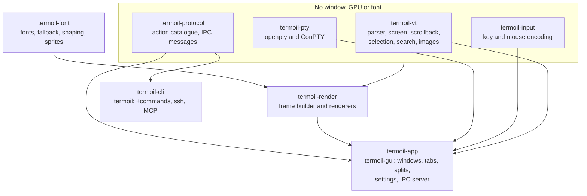
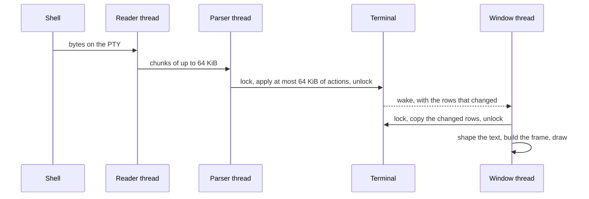
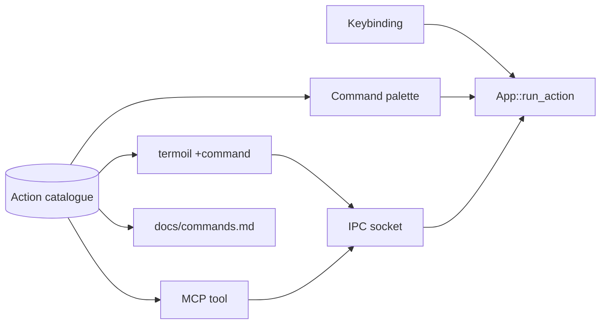

# Architecture overview

This page explains how Termoil is built, in one page and with no Rust: the crates, the threads, how a program's
output becomes pixels, and how a key press reaches the program. [The technical design](TDD.md) has the full detail
and the reasons for each choice.

## The crates

The four crates at the top have no window, GPU or font dependency, and CI builds them for WebAssembly to keep it that
way. The terminal is a plain value: `termoil-vt` holds no thread and no lock, so it can be tested and fuzzed on its
own, and another program can embed it and draw it however it likes.

## From a program's output to the screen

**Reading.** A reader thread reads the pseudo terminal into a 64 KiB buffer. While output is streaming it waits a
millisecond between reads, so a program's thousands of small writes arrive as a few large chunks. On Windows this
took the window thread's processor time for 100 MB of output from 81 seconds to 38.

**Parsing.** The parser thread finds the next control byte with `memchr` and checks printable UTF-8 in bulk with
`simdutf8`, so plain text never goes through the state machine one byte at a time. It turns the bytes into typed
actions (print this text, move the cursor, set this style) and applies them to the terminal in slices of at most
64 KiB, so the window never waits long for the lock during a flood of output.

**Storing.** The screen and scrollback are stored in pages, the design Ghostty uses. A page is one block of memory
holding rows, cells, a table of the styles they use and the extra text of long grapheme clusters, with every
reference inside it stored as an offset. A cell is 64 bits. History that has scrolled out of view is compressed with
LZ4 when the terminal is idle, which is how a million lines fit in 143 MB. Every buffer the parser keeps has a fixed
limit, so a hostile stream cannot make Termoil use unbounded memory.

**Drawing.** The window thread copies only the rows that changed, under the lock, and does everything else outside
it. The frame builder turns the rows into a list of background spans, shaped glyph runs, underlines, images and the
window's own controls, and a `Renderer` draws the list:

| Renderer | When it is used |
|---|---|
| `RasterRenderer` | the default. Termoil's own CPU renderer: each glyph is rasterized once and kept as a mask, only rows that changed are redrawn, and a scroll moves pixels instead of redrawing them. An idle window takes 13 MB |
| `VelloGpuRenderer` | `window.renderer = "gpu"`, or when a custom shader is set. vello on wgpu, on DX12, Vulkan, Metal or OpenGL |
| `VelloCpuRenderer` | the reference the pixel tests render with |

A frame is drawn only when something changed. While output streams and nobody is typing, frames are capped at
`window.output_fps` (60), because streaming output changes every row of every frame and drawing faster shows nothing
new. The first frame after a key press is never held back.

## From a key press to the program

The window turns the system's key event into one platform independent event, handling AltGr, dead keys and the
Windows key first. `termoil-input` then encodes it for the program's keyboard mode: the legacy xterm encoding,
`modifyOtherKeys`, or the kitty keyboard protocol with any of its five flags. The bytes go to the pseudo terminal.
A key reaches the screen in under 2 ms at the median.

## On Windows

Windows programs talk to a terminal through ConPTY, Microsoft's pseudo console. The ConPTY built into Windows
removes sixel and kitty graphics sequences before the terminal sees them, so Termoil ships a matched copy of
Microsoft's `conpty.dll` and `OpenConsole.exe` beside its executable and loads that first. ConPTY does not repaint
after a resize, so Termoil reflows its own scrollback.

## Every action through one function

Every action is a row in the catalogue in `termoil-protocol`, and `App::run_action` is the only function that turns
an action into a change. A key, the command palette, the command line and an AI agent all reach the same code, and the
command reference and the MCP tool list are generated from the catalogue. [Scripting and AI agents](scripting-and-agents.md)
shows how to use it.

## Windows, tabs and panes

One `termoil-gui` process runs every window. A window holds tabs, a tab holds a tree of splits, and each leaf of the
tree is a pane. A pane owns one session: the pseudo terminal, the terminal and its reader and parser threads. Tabs and
splits live entirely in `termoil-app`, above a session that could later move to another process.
