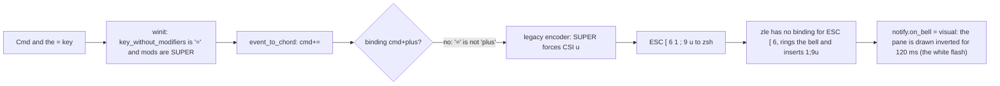

# Keyboard shortcuts that do not reach the shell (task-2589)

## The report

task-2589: "When I run commands like CMD + + to increase font size, the screen flashes white, and "1;9u" shows up in the terminal. Our testing needs to validate our keyboard shortcuts work as expected. We need thorough real world e2e testing to ensure users don't encounter issues before we do."

## What was wrong

Three faults combine. The first one causes the report; the other two turn a missed binding into garbage in the shell.

1. **The font size bindings never matched a real key.** The defaults are `cmd+plus` and `ctrl+plus`. A binding is looked up by the key without modifiers, and on a US keyboard the plus sign is Shift and the `=` key. Cmd and `=` arrives as `cmd+=`, and Cmd, Shift and `=` arrives as `cmd+shift+=`. Neither is `cmd+plus`, so increasing the font size with the keyboard never worked on any platform. The tests did not catch it because `press_binding` in the E6 test built the key from the binding text with `chord_to_event`, which turns `plus` into the character `+`, a key no US keyboard sends.
2. **Super and the C0 keys went out as CSI u to programs that never asked for it.** In the legacy encoding (no kitty flags, modifyOtherKeys 0) a character key with Super, Hyper or Meta held was sent as `CSI code ; mods u`. A shell in legacy mode cannot read that. zsh rings the bell on the unknown prefix and inserts the rest as text, which is the `1;9u` in the report. Ctrl and Shift and a key with no control byte (`ctrl+shift+=`) had the same problem through the `ctrl && shift` rule.
3. **The release of a key that ran a binding still reached the program.** `handle::raw_key` checks only presses against the bindings and gives every release to the pane. Under kitty flag 2 (report event types) the program received a release with no press.

The white flash is the visual bell (`notify.on_bell = "visual"` is the default), which draws the pane inverted. Changing the font size does not resize the window or clear it.

## The design

### Bindings match the key the layout typed, as well as the key itself

`RawKey` gets a `shifted` field: the character the layout types for this key with Shift held, taken from winit's `logical_key` (which applies Shift and ignores Ctrl and Cmd) when Shift is down. The normalizer copies it into `KeyEvent::shifted_key` when the event has no text of its own, because the text is dropped for every key with Ctrl, Alt or Super held.

`keymap::event_chords(ev)` returns the chords a key event can match, in order:

| Order | Chord | Example: Cmd, Shift and `=` on a US layout |
|---|---|---|
| 1 | The key and every modifier held | `cmd+shift+=` |
| 2 | When Shift is held and the layout reports a shifted character: that character, without Shift | `cmd+plus` |

`handle::binding` tries each chord in order and takes the first one that is not `Lookup::None`. A binding written for the exact chord always wins over the shifted form, so `ctrl+shift+0` bound to something still runs that and not `ctrl+=`.

The default bindings gain `cmd+=` (macOS) and `ctrl+=` (Windows and Linux) for `increase-font-size`, next to the existing `plus` forms. Browsers and VS Code accept the `=` key without Shift for zoom in, and that is the key people press when they say "Cmd +".

### Keys a legacy program cannot read send nothing

In the legacy encoding, when the program has not turned on modifyOtherKeys or the kitty protocol:

| Key | Before | After |
|---|---|---|
| Character key with Super, Hyper or Meta | `CSI code ; mods u` | nothing |
| Enter, Escape, Tab or Backspace with Super, Hyper or Meta | `CSI code ; mods u` | nothing |
| Cursor, function and editing keys with Super | `CSI 1 ; 9 A` and similar | unchanged (xterm form, programs parse or ignore it) |
| Ctrl+Shift and a key with no control byte (`ctrl+shift+=`) | `CSI code ; 6 u` | unchanged (xterm sends the same with modifyOtherKeys off; bound keys no longer reach it) |

With modifyOtherKeys 1 or 2 or any kitty flag the program has said it reads these forms, so they are sent as before.

### A key that ran a binding is not given to the program

`WinState` keeps the set of keys whose press ran a binding (`swallowed`). A repeat of such a key is checked against the bindings again (holding Cmd and `=` keeps growing the font). A release of such a key is dropped and the key leaves the set. Focus loss clears the set.

## Tests

The bug escaped because the tests pressed keys that no keyboard sends. Every test below presses keys as winit reports them for a US layout, built by one function in `crates/termoil-app/tests/common/keyboard.rs` (`us_key`), which documents what winit gives for each platform: the key without modifiers, the physical key, the modifiers, the text (dropped by the normalizer for command keys) and the shifted character from `logical_key`.

| Test | Where | What it proves |
|---|---|---|
| **K1 every default binding** | `tests/e7_keyboard.rs`, a real winit window and the real shell | For the Windows and Linux table and the macOS table in turn, every default binding is pressed as a US keyboard sends it. Each binding's action is replaced by a `set-title` probe, so the test sees which binding ran without opening windows or settings. The tab title must name that binding, the shell must receive no bytes, and the bell must not ring. |
| **K2 font size** | `e7_keyboard.rs` | With the real bindings, `=` with the platform modifier, then with Shift, raises `points` by one each; `-` lowers it; `0` resets it. Holding the key (repeat events) keeps raising it. Nothing reaches the shell and the bell does not ring. |
| **K3 kitty release** | `e7_keyboard.rs` | With kitty flags 1, 2 and 8 on (every key an escape code, releases reported), a key that runs a binding sends neither its press nor its release. A key that does not run a binding still sends both (`CSI 97u` then `CSI 97;1:3u` for `a`). |
| **K4 unbound command keys** | `e7_keyboard.rs` | Super with `j`, Enter, Shift and `=`, and `/` send nothing in legacy mode, and `+`, `=`, `>` and `_` typed with no modifier still reach the shell and show at the prompt. Ctrl and `=` with no binding still types `=`, as in xterm, because Ctrl leaves a key with no control byte alone. |
| **K5 real keystrokes** | `tests/e8_real_keys.rs`, opt in with `TERMOIL_REAL_KEYS=1` | Starts the built `termoil-gui` with its own socket and config, brings its window to the front and sends real keystrokes through the operating system (Windows `SendInput`; macOS `osascript` System Events, which needs the Accessibility permission). Reads the pane's columns and screen over IPC: the font size keys change the column count, and the prompt line has no `=`, `+` or `;9u`. Stops at once if another window takes the foreground, so a keystroke is never sent to a window that is not the test's. |
| Encoder tables | `crates/termoil-input/tests/legacy.rs` | The I1 row "Super, hyper and meta use the CSI u form" becomes "send nothing with modifyOtherKeys off" plus rows showing the CSI 27 form at level 1 and 2. |
| Normalizer | `crates/termoil-input/tests/normalize.rs` | `shifted` reaches `shifted_key` for a command key, and the text still wins when the event has text. |
| Keymap | `keymap.rs` unit tests | `event_chords` order, and an exact binding beating the shifted form. |
| E6 | `tests/e6_window.rs` | `press_binding` uses `us_key`, so every binding E6 presses is pressed the way a keyboard presses it. |

K5 is the only test that drives the operating system's keyboard. It is opt in because it takes the foreground on the desktop it runs on. On Windows a new process may not take the foreground from another program, so the test attaches its input to the thread of the window in front for the moment it calls `SetForegroundWindow`, sends no key to that window, and gives the foreground back when it ends, even on a failure.

### Results on the Windows PC (2026-11-09, PowerShell 7 with PSReadLine, US layout)

| Code | `TERMOIL_REAL_KEYS=1 cargo test -p termoil-app --test e8_real_keys` |
|---|---|
| With the fix | Passed in 2.4 s. Columns 120, then 109 after Ctrl and `=`, 100 after Ctrl, Shift and `=`, back up after Ctrl and `-`, 120 after Ctrl and `0`. The prompt line `PS C:\Users\jason>` was unchanged and `echo e8typed` ran. |
| `handle.rs`, `keys.rs` and `legacy.rs` as in 1.5.7 | Failed: "timed out waiting for the platform modifier and = to make the font larger". |

E7 on the code as in 1.5.7 failed on its first binding: `ctrl+plus (increase-font-size): ran None` and `the shell was sent "\x1b[61;6u"`, the Ctrl form of the `1;9u` in the report.

The PC desktop was in use by task-2539's Melodyne driver, which also uses `SetForegroundWindow`, so E8 ran in a quiet window task-2539 granted (paused 23:39Z, resumed 23:47Z). The macOS form of E8 is compile checked for `aarch64-apple-darwin` but has not been run on the MacBook.

## Alternatives considered

| Option | Why not |
|---|---|
| Rewrite the default to `cmd+=` only | Breaks layouts where `+` is its own key (German, Nordic), where `ctrl+plus` is what matches today. Matching both forms covers both. |
| Match bindings by physical key (US position) | Wrong for every non-US layout: `cmd+z` on AZERTY would fire on the W key. |
| Keep CSI u for Super in legacy mode and turn the visual bell off | Hides the bell and leaves `1;9u` typed into the shell for every unbound Cmd key. |
| Make K5 run in the default suite | It moves focus on the person's desktop and needs Accessibility on macOS. The in process K1 to K4 cover the same code from `RawKey` on; K5 covers the winit conversion that only the OS can produce. |
